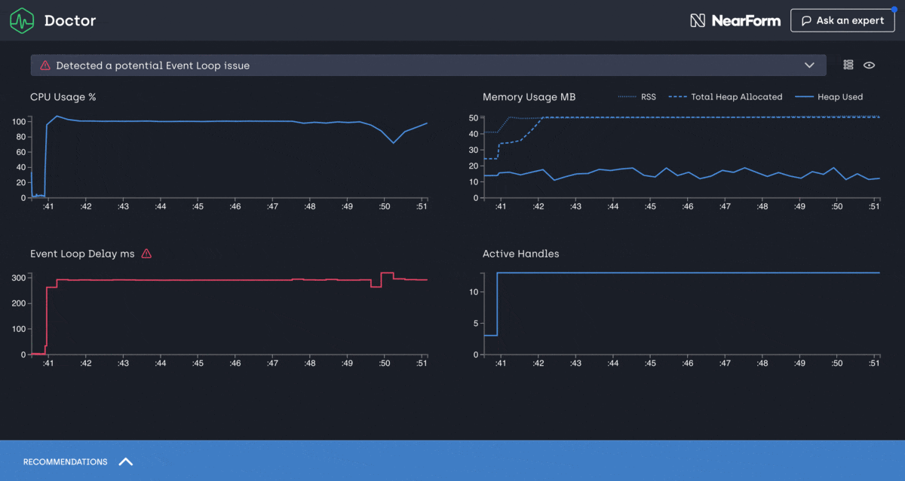

# Clinic.js

> [!NOTE]  
> Clinic.js is not being actively maintained. Due to its strong ties to Node.js internals, it may not work or the results you get may not be accurate.

[](https://greenkeeper.io/)
[![npm version][npm-version]][npm-url] [![Stability Stable][stability-stable]][stability-docs] [![Azure build status][azure-status]][azure-url]
[![Downloads][npm-downloads]][npm-url] [![Code style][lint-standard]][lint-standard-url]

An Open Source Node.js performance profiling suite originally developed by [NearForm][].

Demo and detailed documentation: https://clinicjs.org/

## Install

```
npm install -g clinic
```

<br />



## Getting started

As a first step, run the `clinic doctor`:

`clinic doctor -- node server.js`

Then benchmark your server with `wrk` or `autocannon`:

```
wrk http://localhost:3000
autocannon http://localhost:3000
```

If you want to run autocannon as soon as your server starts listening you can
use the `--autocannon` option using [subarg][] syntax.

```sh
clinic doctor --autocannon [ / --method POST ] -- node server.js
```

Other benchmarking tools like wrk can be started in a similar way using the `--on-port` flag

```sh
# $PORT is the port the server is listening on
clinic doctor --on-port 'wrk http://localhost:$PORT' -- node server.js
```

Finally shut down your server (Ctrl+C). Once the server process has shutdown
`clinic doctor` will analyse the collected data and detect what type of issue
you are having. Based on the issue type, it will provide a recommendation for
you.

For example, to debug I/O issues, use `clinic bubbleprof`:

```
clinic bubbleprof -- node server.js
```

Then benchmark your server again, just like you did with `clinic doctor`.

Note that when looking at the CPU graph you might notice that it doesn't
necessarily go from 0-100 but might go from 0-200 or higher. This is because the
percentage reflects the total amount of CPU cores your computer has. Node.js
itself uses more than one thread behind the scene even though JavaScript is
single threaded. V8 (The JavaScript engine) runs the garbage collector and some
optimizations on background threads. With worker threads, the CPU will also
utilize more than 100%. The visible percentage is always the combination of all
these factors together.

__NOTE__: Exiting the process forcefully can result in wrong or no generation of log files.

### Windows + PowerShell

In order to diagnose your application with node clinic, you should execute your application after double hyphens(`--`),
e.g: `clinic doctor -- node myapplication.js`.

On Windows using PowerShell as terminal the above statement might not work because PowerShell parses everything after `--`
as literal arguments instead of options.

To avoid that behavior you can either quote ("--", '--') or escape (`--`) the double hyphens.

## Supported Node.js versions

Clinic.js relies heavily on Node.js core instrumentation available in later versions.
Currently the supported Node.js versions are `>= 16`.

## Examples and Demos

- [A set of simple Doctor examples](https://github.com/clinicjs/node-clinic-doctor-examples)
- [A set of simple Bubbleprof examples](https://github.com/clinicjs/node-clinic-bubbleprof-examples)
- [A MongoDB-based Bubbleprof demo/example](https://github.com/clinicjs/node-clinic-bubbleprof-demo)
- [A Flame demo/example](https://github.com/clinicjs/node-clinic-flame-demo)

## Report an issue

If you encounter any issue, feel free to send us an issue report at:

```
https://github.com/clinicjs/node-clinic/issues
```

## More information

For more information use the `--help` option:

```
clinic doctor --help
clinic bubbleprof --help
clinic flame --help
clinic heapprofiler --help
```

- The `doctor` functionality is provided by [Clinic.js Doctor](https://github.com/clinicjs/node-clinic-doctor).
- The `bubbleprof` functionality is provided by [Clinic.js Bubbleprof](https://github.com/clinicjs/node-clinic-bubbleprof).
- The `flame` functionality is provided by [Clinic.js Flame](https://github.com/clinicjs/node-clinic-flame).
- The `heapprofiler` functionality is provided by [Clinic.js Heap Profiler](https://github.com/clinicjs/node-clinic-heap-profiler).

## Flags

```
-h | --help                Display Help
-v | --version             Display Version
--collect-only             Do not process data on termination
--visualize-only datapath  Build or rebuild visualization from data
--on-port                  Run a script when the server starts listening on a port.
--autocannon               Run the autocannon benchmarking tool when the server starts listening on a port.
--dest                     Destination for the collect data (default .).
--stop-delay               Add a delay to close the process when a job is done through either `autocannon` or `on-port` flag (milliseconds)
--name                     The --name flag sets a name for the output data, allowing you to replace existing reports without generating new ones. Example: <code>.clinic/node-19-test.clinic-flame</code>
```

## Programmable Interfaces

Each of the tools has a programmable interface which you can read about in their repos.

- [Clinic.js Doctor](https://github.com/clinicjs/node-clinic-doctor)
- [Clinic.js Bubbleprof](https://github.com/clinicjs/node-clinic-bubbleprof)
- [Clinic.js Flame](https://github.com/clinicjs/node-clinic-flame)
- [Clinic.js Heap Profiler](https://github.com/clinicjs/node-clinic-heap-profiler)

## Profile a declared workload

For repeatable runs, add a workload to `profile-workloads.json` in your project.
Run it with Clinic Flame (the default) from that project directory:

```sh
node /path/to/node-clinic/bin/profile-clinic.js --workload fibonacci --param iterations=10
```

This command runs the `fibonacci` workload with Clinic Flame. Use
`--profiler clinic-doctor`, `--profiler clinic-bubbleprof`, or
`--profiler clinic-heapprofiler` to select another supported profiler, provided
the workload allows it. The command writes a JSON report and saves the profile
files in `.clinic-runs/` in your project directory.
The checked-in workload uses three warmups and ten unprofiled throughput
samples before Clinic collects the profile. The report stores those samples
and their median; compatible comparisons use a deterministic bootstrap interval
for the candidate's change against the selected baseline. Workloads without a
measurement plan run once without profiling to capture a descriptive throughput
sample; comparisons report a point delta with uncertainty marked unsupported.

## Use the profiling MCP server

The MCP server reads `profile-workloads.json` from its configured working
directory once at startup, validates it, and keeps an immutable in-memory
snapshot for that server process. Tool calls cannot add or change workload
executables, and editing the JSON file while the server runs does not change its
registered workloads. The server rejects runs if the file changes after
startup; restart it to load a reviewed manifest update.
Set `cwd` to the project you want to profile so workload definitions and
`.clinic-runs/` stay with that project. Each workload lists the profilers it
allows. For example, when `fibonacci` allows `clinic-flame`, start it with:

```json
{"workload":"fibonacci","profiler":"clinic-flame"}
```

Available profilers are `clinic-doctor`, `clinic-bubbleprof`, `clinic-flame`,
and `clinic-heapprofiler`. The profiler must be listed for that workload in the
project manifest.

The MCP server can show available workloads and start a profile. `start_profile_run`
returns a queued or running run; reuse its `run_id` and `run_capability` with
`wait_profile_run` or `get_profile_status` until it completes. Use
`get_profile_findings` to see findings with the highest measured impact first;
long result lists are split into pages. Request individual finding details when needed.
`get_profile_artifact` can list files for a completed run's `artifact_ref` and
return bounded base64 pages when given one listed relative path. It requires
the same `run_id` and `run_capability` as the run. Profile files stay in the
project and are not uploaded automatically.

Example MCP configuration:

```toml
[mcp_servers.node-clinic]
command = "node"
args = ["/absolute/path/to/node-clinic/bin/profile-mcp.js"]
cwd = "/absolute/path/to/your/project"
```

On Linux, install Bubblewrap (`bwrap`) and use a systemd user session with
cgroup v2 and unprivileged user namespaces enabled. Start the server with the
bundled rootless provider by setting `CLINIC_PROFILE_SUPERVISOR=systemd-bwrap`
in its MCP environment. The bundled provider needs Bubblewrap options
`--bind-fd`, `--disable-userns`, and `--assert-userns-disabled`; it was tested
with Bubblewrap 0.9.0. For example:

```toml
[mcp_servers.node-clinic]
command = "node"
args = ["/absolute/path/to/node-clinic/bin/profile-mcp.js"]
cwd = "/absolute/path/to/your/project"
env = { CLINIC_PROFILE_SUPERVISOR = "systemd-bwrap" }
```

The provider applies CPU and memory limits in a systemd user scope and uses
Bubblewrap for private user, network, and process namespaces and a restricted
filesystem. MCP profiling fails closed if the required Linux facilities or
Bubblewrap options are unavailable. The manual `profile-clinic` CLI remains
available for local runs that do not use the MCP isolation policy.

The server hashes the Node executable and installed Clinic dependencies into
the report's toolchain digest. This digest comes from the installed files and is
informational metadata. Runs with a declared wall-clock limit above 30 seconds or a
memory limit above 512 MiB require explicit user confirmation through MCP
elicitation; clients without elicitation support cannot approve an expensive
run. MCP responses
are capped at 12,000 characters; findings are paginated and sorted by measured
impact. Default estimated-token limits are 64,000 per run, 256,000 per session,
1,000,000 per rolling 24-hour window, and 2,000,000 per server process.

Workloads are declared in the project's `profile-workloads.json` using the
[workload manifest schema](docs/schemas/profile-workload.schema.json) and
[workload entry schema](docs/schemas/profile-workload-entry.schema.json).
Reports and MCP payloads are validated against the
[performance report](docs/schemas/performance-report.schema.json),
[run status](docs/schemas/run-status.schema.json),
[MCP envelope](docs/schemas/mcp-response-envelope.schema.json), and
[findings page](docs/schemas/mcp-findings-page.schema.json) schemas. The
profiling tools execute only declared workloads, disable network access, and
keep raw Clinic artifacts local; MCP artifact access requires an explicit
run-scoped request. Artifacts expire after 24 hours.

## Profiling In [Podman](https://podman.io/) Container
_Applicable for `doctor`, `bubbleprof`, `flame` or `heapprofiler`_

In case you profile your application inside of container environment using [podman](https://podman.io/) (docker alternative).
And you start profling by providing `CMD` step in the dockerfile.
```
CMD clinic flame -- node index.js
```
Then when you run container it exits immediately with `0` code.
It is caused by a [question to collect anonymous usage statistics](https://github.com/clinicjs/node-clinic/issues/79#issuecomment-1226515723).

A workaround is to use environment variable `NO_INSIGHT` with any value.
In this case the question to collect anonymous usage statistics is suppressed. Thus profinling and application server start as expected.
```
CMD NO_INSIGHT=true clinic flame -- node index.js
```

## License

[MIT](LICENSE)

[stability-stable]: https://img.shields.io/badge/stability-stable-green.svg?style=flat-square
[stability-docs]: https://nodejs.org/api/documentation.html#documentation_stability_index
[npm-version]: https://img.shields.io/npm/v/clinic.svg?style=flat-square
[npm-url]: https://npmjs.org/package/clinic
[npm-downloads]: http://img.shields.io/npm/dm/clinic.svg?style=flat-square
[lint-standard]: https://img.shields.io/badge/code%20style-standard-brightgreen.svg?style=flat-square
[lint-standard-url]: https://github.com/feross/standard
[azure-status]: https://dev.azure.com/node-clinic/node-clinic/_apis/build/status/nearform.node-clinic
[azure-url]: https://dev.azure.com/node-clinic/node-clinic/_build/latest?definitionId=1?branchName=master
[nearform]: https://www.nearform.com
[subarg]: https://npmjs.com/package/subarg
